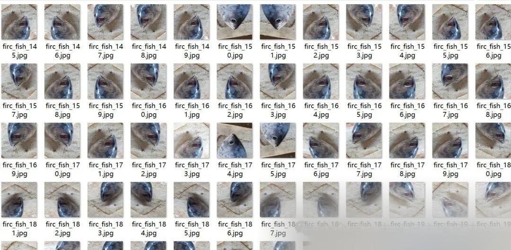
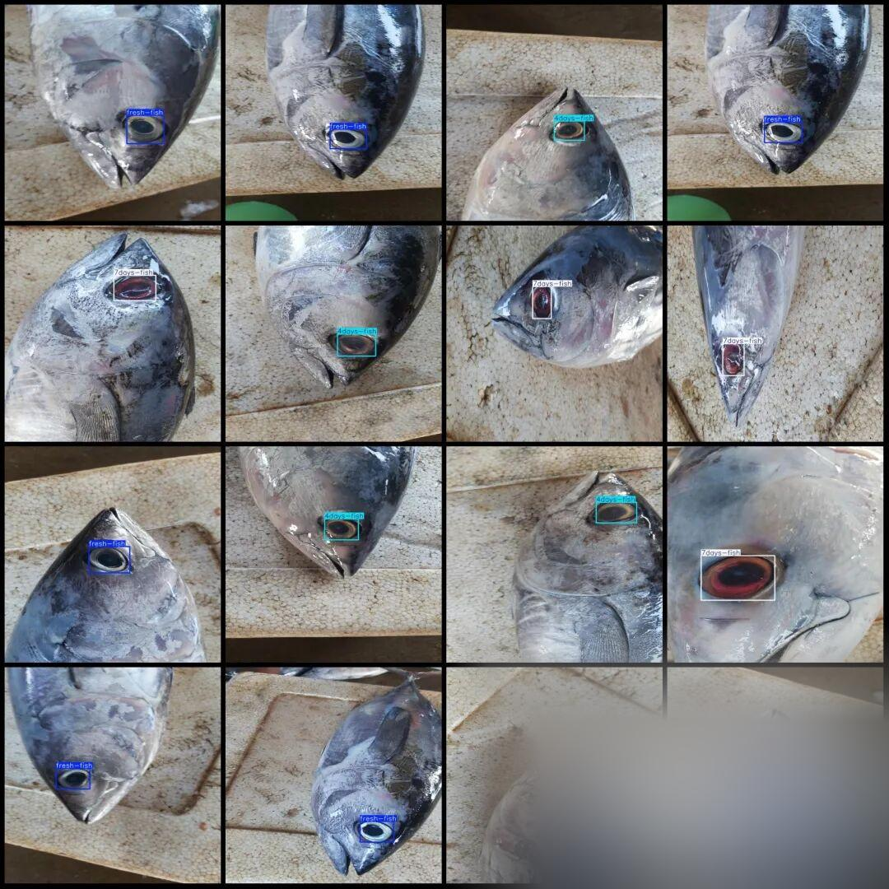

# Freshness Detection Dataset for Fish in VOC+YOLO format with 2569 images and 3 categories of fish eye judgments.

Please carefully review the image preview in the dataset for enhanced images.

Dataset format: Pascal VOC format + YOLO format (txt file without split path, only containing jpg images and corresponding VOC format xml files and yolo format txt files)

Number of images (number of jpg files): 2569

Number of annotations (number of xml files): 2569

Number of annotations (number of txt files): 2569

Label category count: 3

Label category names (note that the format of yolo does not correspond to this, but is based on the labels folder's classes.txt): ["4days-fish", "7days-fish", "fresh-fish"] => [Place fish within 4 days, Fresh fish, Place fish within a week]

Number of boxes labeled in each category:

4days-fish Frame Count = 659

7days-fish frame count = 965

Fresh-fish frame count = 945

Total frames: 2569

Using labelImg:

Annotation rules: Draw a rectangle around the category.

Important Notice: No

Special : This dataset does not guarantee the accuracy or precision of the trained models or weight files. The dataset is provided with accurate and reasonable annotations only.

Image Preview:

Annotation example:

## Payment

Here is a pay link on Stripe ( https://buy.stripe.com/3cs8yP7sY87d0vu9AB ). Please contact me lonlonago@foxmail.com after funding $89, and I will send you a complete data files , thank you!

